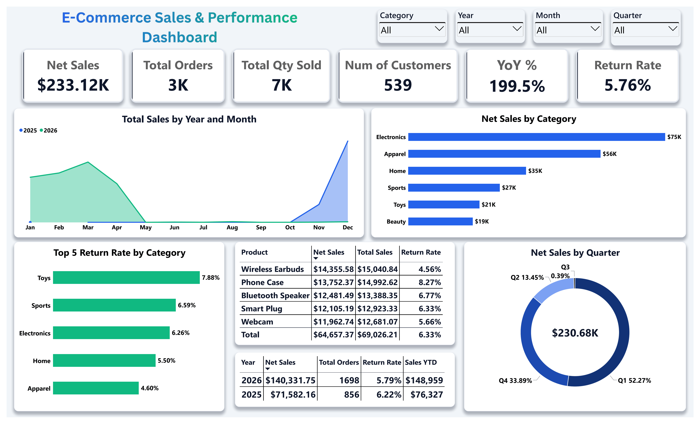

# 🛒 End-To-End E-Commerce Sales & Performance Analytics

## 📌 Project Overview
An end-to-end interactive Business Intelligence project analyzing e-commerce sales performance across **2025 and 2026**, tracking net revenue, order volume, customer base, Year-over-Year (YoY) growth, and product/category return rates. Starting from raw transactional data explored in **SQL** and transformed in **Power Query** into a clean **Star Schema**, the solution combines **DAX** time-intelligence measures with an interactive **Power BI** dashboard styled with a consistent dual-tone color palette (**Blue** for `2025` and **Green** for `2026`) and a custom gradient header.

## 🔗 Live Interactive Dashboard

[View the Live Dashboard Here](https://app.powerbi.com/view?r=eyJrIjoiN2FmMWVhNGEtOTg4Yy00MmI5LTk0YjctODQ4MWFkNzE2MzhkIiwidCI6IjJiYjZlNWJjLWMxMDktNDdmYi05NDMzLWMxYzZmNGZhMzNmZiIsImMiOjl9)

---

## 📋 Dataset Scope & Coverage
> **Data Overview:** This dataset contains e-commerce order-level records spanning **2025 and 2026**, enabling multi-year revenue tracking, seasonal trend comparison, return rate diagnostics, and SKU-level performance evaluation.

### **Included Data Attributes:**
- **Time & Calendar Dimensions:** Order dates mapped to a dedicated calendar table (`dim_date`) covering *Year, Quarter, and Month* for chronological analysis and Year-to-Date / Prior-Year comparisons.
- **Product & Category Hierarchy:** Product names/SKUs and categories (*Electronics, Apparel, Home, Sports, Toys, Beauty*) linked through `dim_products`.
- **Customer & Order Records:** Order identifiers, customer counts (`dim_customers`), quantities sold, gross sales (`Total Sales`), net revenue (`Net Sales`), and return indicators (`fact_orders`).

---

## 🧹 Data Cleaning & Transformation (SQL & Power Query)
Raw e-commerce records were inspected and prepared before building the semantic model:
- **SQL Exploration & Metric Validation:** Queried raw transactional data in `ecommerce_orders.sql` to verify date coverage (`2025–2026`), order counts, pricing/quantity fields, and return behavior, cross-checking baseline KPIs prior to reporting.
- **Star Schema Normalization:** Restructured the raw data in **Power Query** into a clean **Star Schema** comprising `fact_orders` connected via one-to-many (`1:*`) single-direction relationships to `dim_date`, `dim_products`, and `dim_customers`.
- **Handling Blank & Null Values:** Filtered out `(Blank)` entries across date attributes (*Year, Month, Quarter*) and categories to prevent blank slicer options and visual clutter.
- **Data Types & Calendar Enrichment:** Standardized numeric, currency, percentage, and date types, and configured month/quarter sorting so time-series charts display in true chronological order.

---

## 📐 DAX Modeling & Visualization (Power BI)
1. **DAX Measures & Time Intelligence:**
  - Built core KPI measures including `Total Sales`, `Net Sales` (`$233.12K`), `Total Orders` (`3K`), `Total Qty Sold` (`7K`), `Num of Customers` (`539`), and `Return Rate` (`5.76%`).
  - Implemented time-intelligence measures (`Sales YTD`, `Sales PY`, and `YoY %`) to benchmark **2026** performance against **2025**.
2. **Executive Dashboard Design:**
  - Structured the canvas with 6 top KPI cards, a multi-year monthly trend chart (`Total Sales by Year and Month`), category and product performance visuals, a quarterly donut chart (`Net Sales by Quarter`), and a yearly comparison table.
  - Integrated four interactive slicers (*Category, Year, Month, and Quarter*) alongside a transparent gradient title header.

---

## 📊 Key Insights
| Metric / Dimension | Key Finding |
| :--- | :--- |
| **Overall Performance** | Net Sales reached **$233.12K** across **3K** orders (**7K** units sold) and **539** customers, with an overall **5.76%** return rate. |
| **YoY Growth (2026 vs. 2025)** | Net Sales rose **199.5% YoY** from **$71,582.16** (**856** orders) in **2025** to **$140,331.75** (**1,698** orders) in **2026**. |
| **Quarterly Concentration** | **Q1** accounts for **52.27%** of net sales and **Q4** contributes **33.89%**, driving the majority of revenue momentum. |
| **Top Categories** | **Electronics** leads net sales at **$75K**, followed by **Apparel ($56K)**, **Home ($35K)**, and **Sports ($27K)**. |
| **Return Rate & Top SKU** | **Toys (7.88%)** and **Sports (6.59%)** show the highest category return rates; **Phone Case** has an **8.27%** return rate, while **Wireless Earbuds** leads product net sales at **$14,355.58** (**4.56%** return rate). |

---

## 📂 Repository Structure
- `ecommerce_orders.pbix` — Interactive Power BI Desktop report file including Star Schema model, DAX measures, and visuals.
- `ecommerce_orders.csv` — E-commerce order-level dataset.
- `ecommerce_orders.sql` — SQL queries for exploration and validation.
- `Dashboard.png` — High-resolution export of the final dashboard.
- `Data Model.png` — Screenshot of the Star Schema data model.

---

## 👤 Author
**Yahia Farag** — Data Analyst  
*Tools: Power BI · Power Query · DAX · SQL*
